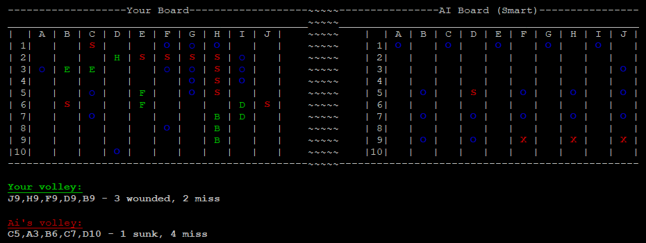
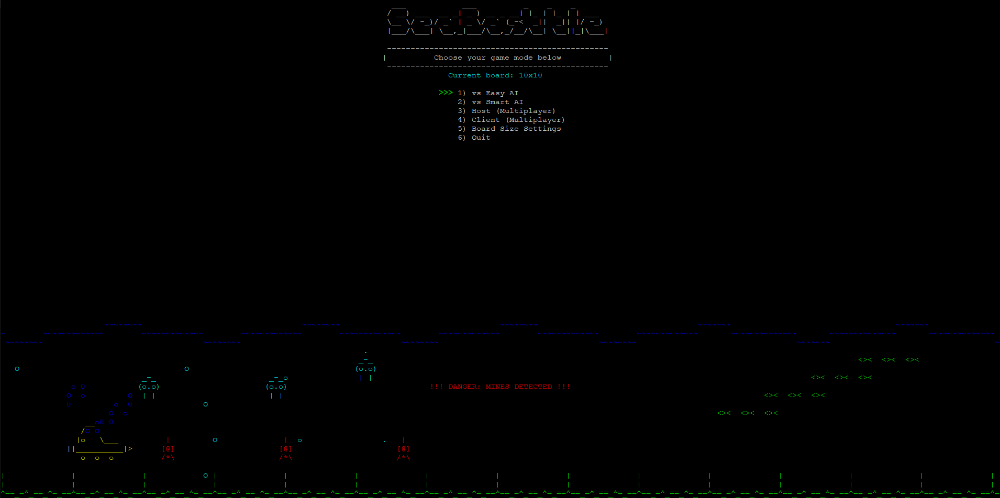
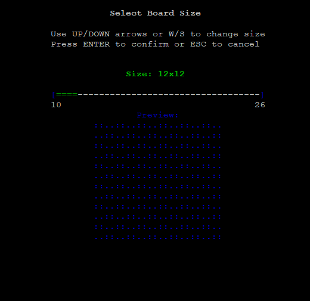
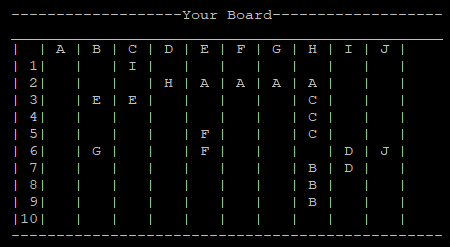

# SeaBattle

A terminal Battleship game in C++ with a text UI (PDCurses / ncurses): play against an easy or a smart AI, or against another player over the network.

It is the salvo variant of the game: each turn you pick several target cells and fire them all at once.

## Screenshots

**Battle against the Smart AI.** Your fleet on the left, the enemy waters on the right; `o` is a miss, `X` a hit, `S` a sunk ship. The log below shows the last volley of each side.



**Main menu** with the animated sea scene.



| Board size settings (10×10 … 26×26) | Random ship placement |
|---|---|
|  |  |

## Features

- **Two AI levels**
  - *Easy*: shoots at random cells.
  - *Smart*: hunt-and-target strategy. While searching it shoots on a checkerboard pattern (every ship of length ≥ 2 covers at least one such cell, so half the board is enough to find it). After a hit it queues the neighbouring cells and finishes the ship before returning to the search.
- **Multiplayer over TCP**: one player hosts, the other connects by IP address (port `8888`). The host accepts or rejects the incoming connection, chooses the board size and shots per turn, and these settings are sent to the client.
- **Configurable game**
  - Board size from **10×10 to 26×26**. The fleet grows with the board: 10 ships on 10×10, up to 40 ships on 26×26.
  - Shots per turn from 1 to 26, with a recommended value for each board size.
- **Ship placement**: random (re-roll until you like it) or manual with a cursor and rotation.
- **Terminal UI**: animated menu and battle effects, a live message log, and a terminal-size check that tells you if the chosen board will not fit in the window.
- **Cross-platform build**: Windows (PDCurses + Winsock) and Linux/macOS (ncurses + BSD sockets) from one Makefile.

## Build

### Windows (MSYS2)

1. Install [MSYS2](https://www.msys2.org/) and open the **MSYS2 MINGW64** shell.
2. Install the compiler and PDCurses:
   ```bash
   pacman -S --needed mingw-w64-x86_64-gcc mingw-w64-x86_64-pdcurses mingw-w64-x86_64-make
   ```
3. Build:
   ```bash
   mingw32-make
   ```
   This produces `battleship.exe`. Run it from the same shell, or copy `libpdcurses.dll` (included in the repo) next to the executable.

### Linux / macOS

```bash
sudo apt install g++ make libncurses-dev   # Debian/Ubuntu; on macOS ncurses comes with Xcode tools
make
./battleship
```

### Make targets

| Target | What it does |
|---|---|
| `make` | Build the game |
| `make release` | Clean rebuild with `-O2` |
| `make debug` | Clean rebuild with debug flags |
| `make clean` | Remove object files and the executable |
| `make info` | Print the detected OS, compiler and flags |

## How to play

Make the terminal window large enough (the game checks it before starting).

**Main menu**: `W`/`S` or arrow keys to move, `Enter` or `Space` to select.

| Menu item | |
|---|---|
| vs Easy AI / vs Smart AI | Single-player game |
| Host (Multiplayer) | Wait for another player to connect |
| Client (Multiplayer) | Connect to a host by IP address |
| Board Size Settings | Choose a board from 10×10 to 26×26 |

**Placing ships**

| Key | Random mode | Manual mode |
|---|---|---|
| `Y` | Accept the board | |
| `N` | Generate a new random board | |
| `M` / `G` | Switch to manual mode | Switch to random mode |
| `W A S D` / arrows | | Move the ship |
| `R` | | Rotate the ship |
| `Enter` / `Space` | | Place the ship |

**Battle**

| Key | Action |
|---|---|
| `W A S D` / arrows | Move the cursor on the enemy board |
| `Enter` / `Space` | Select a target (up to the shots-per-turn limit) |
| `F` | Fire all selected shots |
| `Q` | Quit the game |

The first player to sink the whole enemy fleet wins.

### Multiplayer

1. Player 1 chooses **Host** and waits for a connection. Find the host's local IP address with `ipconfig` (Windows) or `ip addr` (Linux/macOS).
2. Player 2 chooses **Client** and enters that IP address.
3. The host accepts the connection and chooses the shots per turn. Both players place their ships and the battle starts.

Both computers must be on the same network (or port `8888` must be reachable), and the firewall must allow the connection.

## Project structure

```
main.cpp            entry point and main menu
ai/                 AI player: easy and smart (hunt / target) strategies, single-player game loop
game/               board, ships, fleet configuration per board size, board-size and shots menus
network/            host (server) and client connection setup
user/               human player: ship placement, turn loop, network message exchange
ui/                 colors, animations, layout helpers
utils/              terminal, text and game-logic helpers
```

## Tech

C++11 · PDCurses / ncurses · Winsock2 / BSD sockets (TCP) · GNU Make

## License

[MIT](LICENSE)
